 <!-- HERO CARD -->

  

<!-- SOCIAL / PROFILE TILES -->

  
  
  

---

## ABOUT ME

I'm Nishit Soni, an aspiring **AI/ML Engineer and Software Developer** passionate about building intelligent systems and meaningful digital experiences.

- Interested in Artificial Intelligence, Machine Learning and Data Science.
- Building full-stack applications and intelligent automation systems.
- Exploring modern technologies and solving real-world problems.
- Constantly learning, experimenting and improving my skills.

**Portfolio:** [nishvay-portfolio-v2.vercel.app](https://nishvay-portfolio-v2.vercel.app/)

---

<!-- ACTIVITY CARD -->
## GITHUB ACTIVITY

  

---

## TECH STACK

**Languages**

  

**Frontend & Backend Development**

  

**AI / ML & Data Science**

  

**Databases & Cloud**

  

**Tools**

  

---

## FEATURED PROJECTS

  
  
  
  

Explore more projects on my [GitHub repositories](https://github.com/Nishit-soni-01?tab=repositories).

---

## CONTRIBUTION GRAPH

  

---

## CONNECT WITH ME

  
  
  

  <i>Building. Learning. Creating. Improving.</i>

  <b>Thanks for visiting my profile!</b>

